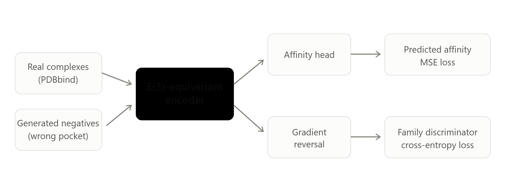

# Does supervision force interaction learning in binding affinity prediction?

Structure-based binding affinity models are widely reported to learn *which*
ligand and *which* protein family they are looking at, rather than *how* the two
interact. This repository tests whether two targeted interventions —
**generated negative complexes** and **adversarial suppression of protein family
identity** — push an E(3)-equivariant model toward interaction features and
improve generalization to unseen protein families.

> **Status: work in progress.** This is an active research project. No
> results are published yet; the numbers in `results/` are provisional until the
> full experiment matrix has been run across three seeds.

## Motivation

The argument, in four sentences:

1. Binding affinity is determined by physical interactions between a ligand and
   a protein pocket.
2. Volkov et al. (2022) showed that models given those interactions explicitly
   do not beat models that never see them — a ligand-only model reached
   *r* = 0.749 against 0.687 for the interaction-aware model. So current models
   appear to recognize identity, not interaction.
3. Two structural properties of PDBbind plausibly cause this: it contains no
   negative examples (every complex in it binds), and it is dominated by a
   handful of protein families.
4. **Hypothesis:** if the model is supplied with negatives and family identity is
   actively suppressed in its representation, it is forced toward interaction
   features and should generalize better to unseen families.

This is a shortcut-learning question (Geirhos et al., 2020) applied to a domain
where the shortcut has already been documented but not, so far, directly
attacked during training.

## Approach



A shared E(3)-equivariant encoder over the protein–ligand complex graph feeds
two heads:

- an **affinity head** trained with MSE against pK<sub>d</sub>/pK<sub>i</sub>, on
  real complexes and on generated negatives;
- a **family discriminator** trained with cross-entropy behind a **gradient
  reversal layer** (Ganin & Lempitsky, 2015), so the encoder is penalized for
  retaining family-identifying information.

Family labels come from clustering training proteins by sequence identity, which
aligns the suppressed information with exactly what the 30%-identity test split
penalizes.

### The parts that are actually hard

| Problem | Why it is hard | Approach taken |
| --- | --- | --- |
| Generating negatives | Naively transplanting a ligand into the wrong pocket creates steric clashes that a model detects in one epoch, teaching it nothing | Aligned ligand swapping, gated by a **triviality diagnostic**: a classifier trained on clash count, ligand atom count and molecular weight alone must stay near chance |
| Defining "family" | The discriminator needs labels that match the generalization gap being measured | Sequence-identity clustering (MMseqs2), aligned with the ATOM3D 30% split |
| Tuning λ | Adversarial training is unstable; too much destroys useful signal, too little does nothing | λ ramped from 0 over the first epochs, swept over several values, with per-epoch discriminator accuracy logged as evidence the mechanism did anything |

The triviality diagnostic is the load-bearing piece. Artificial decoys are known
to introduce their own shortcuts (Chen et al., 2019), so negatives are treated
as a result to be validated, not a preprocessing step.

## Repository layout

```
├── src/lba/
│   ├── data/          # ATOM3D LBA loading, graph construction, featurization
│   ├── models/        # equivariant encoder, affinity head, discriminator, GRL
│   ├── negatives/     # aligned swapping, property matching, triviality diagnostic
│   └── eval/          # metrics, per-family breakdown, perturbation probes
├── scripts/           # environment setup, data download, training entry points
├── configs/           # one YAML per experiment configuration
├── notebooks/         # exploration and figures
├── data/              # not tracked — see "Data" below
├── results/           # metrics tables and figures
└── notebook.md        # dated lab notebook, one entry per working session
```

## Setup

Requires **Python 3.11** (`atom3d` and the PyTorch Geometric companion wheels
have no 3.12+ builds), conda, and an NVIDIA driver supporting CUDA 12.4.

```bash
git clone <repo-url> && cd lba-project
bash scripts/setup_env.sh          # add --mmseqs for the Phase 4 clustering tool
```

Verify at any point:

```bash
.venv/bin/python scripts/check_env.py
```

The pinned versions are in `requirements.txt`. Note that `torch`,
`torch-scatter` and `torch-cluster` require extra package indexes and cannot be
installed from that file with plain `pip install -r`; `setup_env.sh` supplies
them.

**CPU-only:** replace the `cu124` tags in `scripts/setup_env.sh` with `cpu`.
Everything runs, slowly.

## Data

The dataset is the [ATOM3D](https://www.atom3d.ai/) LBA task (derived from
PDBbind), used with its 30% sequence-identity split. It is not tracked in this
repository.

```bash
.venv/bin/python scripts/download_data.py
```

That wraps `atom3d.datasets.download_dataset('lba', ..., split='sequence-identity-30')`
and pulls roughly 1 GB from Zenodo into `data/raw/`.

Generated negatives are reproducible from the raw data and are likewise not
tracked.

## Reproducing

*(Entry points are added as each phase lands; this section is filled in as the
experiment matrix is built out.)*
